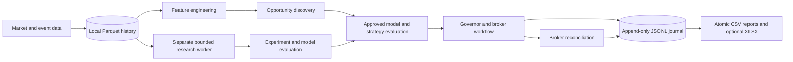

# Local storage and schema contract — V1 proposal

**Status:** design and acceptance specification; no storage code or tests exist yet. This October 15 owner decision supersedes SQLite in the October 8 autonomous proposal and in the supplied branch-3 draft **for V1 only**. Historical research files remain unchanged. The 18 responsibilities, discovery, model evaluation, Governor, broker workflow and learning gates keep their interfaces.

## 1. Formats and ownership

| Format | Purpose | Authority |
|---|---|---|
| Append-only JSONL | Operational events: candidate, decision, risk, order intent, broker observation, fill, reconciliation, outcome, health | Source for replay; exactly one process owns writes and lock |
| Parquet | Equity/crypto bars and point-in-time engineered feature partitions | Immutable published partitions with a hash manifest |
| JSON | Owner-approved configuration, provider profiles, file manifests, model/strategy registry and checkpoints | Versioned, validated, atomically replaced; secrets are aliases only |
| CSV | Opportunity, accepted/rejected trade, experiment, benchmark, latency and performance reports | Derived, reproducible, Excel-readable snapshots; never order authority |
| Native model artifact | Trained model and preprocessing state with SHA-256, code/data hashes and training cutoff | Immutable; loading requires registered version and schema |
| XLSX (optional) | Owner-facing report views | Export only, never an operational ledger |

No SQLite, PostgreSQL, MongoDB, Redis, cloud database or server is a V1 dependency. A future migration requires a measured reason and an adapter contract test against the same replay, idempotency and recovery semantics.



The research branch reads published snapshots; its training and simulations cannot block the Governor, broker reconciliation or order journal.

## 2. Runtime directory plan

`JARVIS_HOME` is an owner-chosen **local directory outside the Git checkout**, with restrictive permissions. Never assume its OS path. Do not create this tree in the documentation phase.

```text
JARVIS_HOME/
  config/owner-policy.json                 # signed/versioned policy reference; no keys
  config/provider-profiles.json
  journal/operational-YYYY-MM-DD.jsonl    # single writer, append only
  journal/manifest.json                    # committed segments, hashes, schema versions
  checkpoints/replay-state.json            # rebuildable cache, not journal authority
  market/equity/<asset>/<year>/<date>.parquet
  market/crypto/<asset>/<year>/<date>.parquet
  features/equity/<asset>/<horizon>/<date>.parquet
  features/crypto/<asset>/<horizon>/<date>.parquet
  news-events/metadata-YYYY-MM-DD.jsonl
  news-events/documents/                   # only where retention rights permit
  research/experiments/*.json
  research/backtests/*.parquet
  research/results/*.csv
  models/artifacts/<model-id>/<version>/
  models/registry.json
  opportunities/candidates.csv
  opportunities/rejected.csv
  trades/approved.csv
  broker/orders.csv
  broker/fills.csv
  risk/decisions.csv
  diagnostics/latency-access.csv
  evaluation/model-comparisons.csv
  performance/benchmarks.csv
  reports/*.csv
  reports/*.xlsx                         # optional
  backups/                                # encrypted copies + restore manifests
  quarantine/                             # corrupt segments/invalid source items
```

The subdirectories holding CSV are **projections**. They can be regenerated from journal, Parquet and versioned research inputs. An operator's edit to a CSV cannot authorize an order or change the audit trail.

## 3. Common schema and typed files

Every important record includes `record_id` (stable UUID/ULID), `recorded_at_utc` (ISO-8601 with `Z`), `asset_id`, `asset_class` (`EQUITY` or `CRYPTO`), `strategy_id`, `strategy_version`, `model_id`, `model_version`, `opportunity_id`, `trade_id`, `event_type`, `source_id`, `source_event_at_utc`, `first_available_at_utc`, `processing_latency_ms` when measurable, `status`, `reason_codes` (stable JSON array in CSV), and `correlation_id`. Nonapplicable values are explicit nulls; a value is never silently fabricated. Every file has a `schema_version`; amounts specify units/currency and every timestamp is UTC. Event and first-available times are distinct, preserving point-in-time replay.

| File or record | Additional required fields | Key and revision rule |
|---|---|---|
| Equity/crypto bars Parquet | `bar_start_utc`, `bar_end_utc`, open/high/low/close, volume, venue/feed, adjustment version, `ingested_at_utc`, quality | `(asset_id, feed, bar_end_utc, source_revision)`; revisions make new immutable partitions |
| Feature Parquet | `feature_name`, `value`, `horizon`, `input_record_ids`, transform hash, `available_at_utc`, `expires_at_utc`, missing/quality flag | `(snapshot_id, feature_name)`; never rewrite historical availability |
| Operational JSONL | common fields plus `event_id`, `event_seq`, `producer_version`, payload, payload SHA-256, previous event hash | One complete JSON object per line; corrections append a new linked event |
| Opportunities CSV | `candidate_id`, scanner version, detection/expiry, trigger, feature snapshot hash, rank, selected/rejected/expired reason | `candidate_id` plus projection version; rejected candidates retained |
| Trade/risk/order/fill CSV | intent ID, client order ID, broker order/fill IDs, policy version, requested/filled quantity, price, fee, broker status, reconciliation status | Broker IDs plus event IDs; late fees and corrections are new events |
| Research/experiments CSV + JSON | hypothesis ID, trial count, data/code hash, split windows, negative result, metric/uncertainty, benchmark | Immutable experiment/version; never retain winners alone |
| Model registry JSON | model/version, asset class, artifact hash, feature schema, training cutoff, evaluation ID, stage, approval and rollback target | Immutable version entries; stage transitions append journal events |
| Diagnostics CSV | stage start/end, feed tier/location, access status, local queue/inference/broker latency, measured/estimated/unknown evidence | Correlation and candidate IDs; missing counterfactuals stay `UNKNOWN` |
| Performance CSV | strategy/model version, period, realized or hypothetical flag, gross/net return, costs, drawdown, Expected Shortfall, baseline and sample | Versioned evaluation; never mix actual and hypothetical P&L |

The [header-only templates](templates/) are safe examples. The schema document is the contract; templates are not proof of implementation.

## 4. `StorageAdapter` boundary

Define a narrow interface in A1: `append_event(event) -> durable_event_id`, `read_events(after_seq, as_of)`, `publish_partition(kind, partition, rows, schema_version) -> manifest_hash`, `read_partition(manifest_hash)`, `publish_registry(versioned_document)`, `load_registry(version)`, `export_report(name, as_of) -> manifest`, `verify()`, and `restore(snapshot)`. Strategies, Governor, model evaluation and broker adapter depend on typed records and this interface, never filesystem paths or CSV parsing. Initial adapter uses local JSONL/Parquet/JSON/CSV. A later database adapter must preserve ordering, durability, identity and as-of semantics.

## 5. Atomicity, recovery and broker truth

1. Acquire an OS file lock for a **single writer per JARVIS_HOME**; refuse a second trading writer. Research jobs read published immutable snapshots and have separate bounded CPU/I/O budgets. They cannot lock the order path.
2. For critical journal events, validate schema, assign stable event and correlation IDs, append one newline-terminated UTF-8 JSON object, flush and fsync before acknowledging durability. Persist an `OrderIntent` with stable `client_order_id` **before** submitting. Do not use a CSV edit or an unsynced checkpoint as evidence that an order was placed.
3. Publish Parquet, JSON manifests, registries and CSV projections by writing to a same-volume temporary file, validating contents, fsyncing the file, atomically replacing the destination, and syncing the containing directory where supported. Hash and count every published file in a manifest. On Windows, verify actual rename/lock behavior in A1 tests.
4. On startup, verify segment hashes and sequence continuity. A truncated final JSONL line may be isolated and recovered only by a tested rule that retains the original bytes in quarantine. **Middle-of-file corruption or unexplained gaps enter SAFE**; never silently skip an event. Rebuild projections/checkpoints from the last valid journal plus pinned partitions.
5. Before any new order after restart, query broker positions, cash, open and recent orders/fills. Match stable client IDs and broker IDs; adopt known fills and append reconciliation events. Unknown orders, positions, fees or incomplete intent state force SAFE until resolved. Retry a timed-out submission only after broker lookup by client ID. Expired candidates remain recorded but cannot be sent.
6. Back up journal, manifests, Parquet, registries, artifacts and owner policy as a consistent, encrypted snapshot. Record hashes and snapshot time. Restore into an isolated directory, verify hashes and replay, then reconcile with broker before any trading. Test power-loss and partial-write cases; do not assert consistency without those tests.

## 6. Acceptance evidence for implementation phases

| Phase | Required demonstrated test (not yet run) |
|---|---|
| A1 | Save/load equity and crypto bars; reproduce features from pinned stored inputs; validate schema/version and model/experiment lineage; reconstruct allowed and rejected decisions from journal; record latency/access events; injected crash at append, fsync and replace leaves a valid recoverable state; backup restores the same hashes. |
| A2 | Heavy research saturates its budget without delaying broker reconciliation or time-critical decisions; incomplete/late text remains optional or yields FLAT when required. |
| A3 | Mock broker timeout/restart/partial-fill and unknown-position drills reconcile actual broker state before an order; same client ID never creates a duplicate order; CSV opens in Excel; report edit cannot affect trading. |
| A4 | Model comparison and promotion reproduce from immutable artifact, trial ledger and data snapshot; rejected experiments remain visible. |
| A5 | Paper history and file-based recovery are independently reviewed; no live enablement follows automatically. |

**Current evidence:** design only. No item in this table is claimed to have passed.
